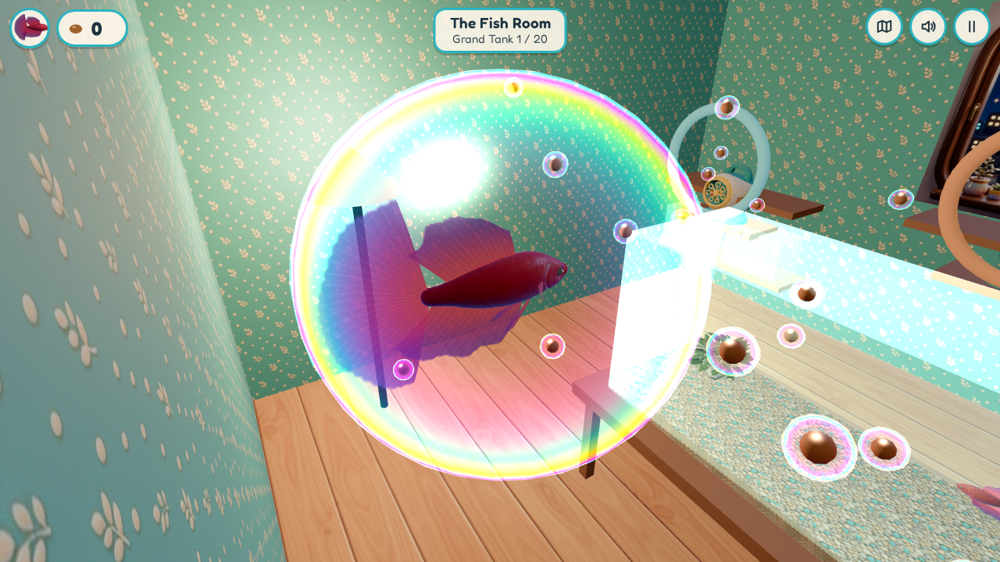

# Bubble Nest

*Swim the pipes. Munch the bites. Build the nests. Collect all 20 bettas.*

You're a betta fish in a little tank with a glass tube hanging into it. Swim up the tube and the world becomes a glowing, Pac-Man-style network of water pipes: munch trails of betta bites, flare your gills to chase off snails and shrimp, and follow the pipes to other tanks. Claim empty tanks with a bubble nest, meet lady bettas, raise their fry, and become each new fish. You can't lose, only collect.

**[▶ Play Bubble Nest](https://bubblenest.synapticnoise.com/)** in your browser. No install, works on desktop and on phones held sideways.

## The worlds

| | |
|---|---|
|  |  |
| **Clearwater:** clear glass pipes on a sunny windowsill. Learn the ropes: bites, brine shrimp, snails, darting shrimp and wrap-around tunnels. | **Copperworks:** pipes in copper fittings in a warm boiler room. Ride the currents, time the steam valves and dodge the crayfish. |
|  |  |
| **Neon Night:** an aquarium shop after hours. The pipes are dark, portal rings whisk you across the maze, and jellyfish pulse. | **The Fish Room:** float in a bubble from one world's bubble machine to the next, past the sleeping cat, with every fish you've collected swimming in the Grand Tank. |

19 named mazes, 28 tanks, 19 lady bettas and 20 bettas to collect, each with its own colours, fins and personality.

## How to play

- **In a tank:** hold the left mouse button to swim toward the pointer, or use WASD. Space rises, Shift dives, right-drag looks around. Eat the bites on the surface, swim to the floating leaf to build a nest, and swim up into the tube to enter the pipes.
- **In the pipes:** arrow keys or WASD to turn (or hold the mouse button). You keep swimming until a wall, like Pac-Man. A brine shrimp makes you flare: enemies flee, and bumping one gives bonus bites.
- **Nests and fry:** exit signs show what's beyond and what a nest costs. Empty tanks become yours (with a feeder and a new bubble trail). Lady bettas lay eggs; they hatch and grow as you eat bites anywhere, and then you can become the grown fry.
- **Action:** E or Enter. **Map:** Tab. **Pause:** Esc or P. **Mute:** M.
- **On a phone** (sideways): the stick on the left swims, drag on the right to look, the arrow buttons rise and dive, and you swipe to turn in the pipes. You can install it from your browser's menu to play full screen, even offline.

Enemies only knock bites out of you, so you can never lose. Progress saves automatically in your browser.

## How it was made

Bubble Nest was made by [Claude Code](https://claude.com/claude-code) with
[gamegen](https://github.com/zeveck/gamegen), from this request:

> --budget 50 We want a 3d game in which you play as a betta fish. The gameplay is arcade simple with some twists. You start able to 3d navigate with mouse or touch around your small tank looking around and nibbling some betta bites floating on the surface. But there's a water filled tube coming down from the top of your tank, and you can swim up into it. When you enter it, you're still 3d but it's basically mechanically be 2d, almost like Pac-Man, except you're swimming. A core mechanic is eating betta bites. The tubes are just a bunch of mazes, again similar to Pac Man difficulty, in which you can munch betta bites and avoid enemies and they branch like pipes or whatever, but they lead to other tanks. Some are empty, some include female bettas. If empty, and you have Z bites, you can claim it by making a bubble nest. If a female betta, you may also make a bubble nest, and then she'll lay a fry and they'll hatch after you gain N bites, and the fry grow up after you eat M more bites, and you can switch to being the fry if you want. Each time you be a new fish, it adds to your betta collection. There's a large network of pipes and passage gets harder and you need more more for the placeholder numbers I gave and they get longer and there are more enemies, but enemies mostly just cause you to lose bites somehow and you can't die. There little to know story, just a pipework of fish, food, and fun, swimming through tubes and getting new tanks and meeting lady fish and getting fry trying to collect all 20 fish or something. It's all bettas. After a while there'll be a pipe with a bubble machine, and if you swim in the betta is put in a 3d bubble they can "float" around a simple room, and it can "dock" at other bubble machines to enter other networks of pipes. There should be three "pipe worlds" with different styles and the like. So it's kinda 3d when you're in a tank, and when you're in the bubble, with 3d controls. But it's kinda simple 2d for the pipes, which is most of the game. Good luck!

gamegen wrote a brief and a design, had review agents (a player, an engineer and an art director) critique it over two rounds, made the art, models, music and sound with these plugins, built the game in three.js, and play-tested it (an autopilot crossed every maze between every pair of exits, and a test run went from New Game to the Full Collection ending):

- [meshgen](https://github.com/zeveck/meshgen): the 3D betta bodies (male and female), snail, shrimp, crayfish, bubble machine, sleeping cat, armchair and the tank decorations. The fins are built in code on top of the bodies, so 20 bettas share two models.
- [imagegen2](https://github.com/zeveck/imagegen2): the Rust concept art that set the style, the concept pictures the 3D models were made from, and the app icon.
- [nanogen](https://github.com/zeveck/nanogen): the title art, the three world panoramas, the tank posters, gravel and Fish Room textures.
- [audiogen](https://github.com/zeveck/audiogen): the music for each world, the tanks and the Fish Room, the victory sting, and 42 sound effects.

The design notes, reviews and asset log are in [`design/`](design/), and the maze layouts and their checker in [`tools/`](tools/).

## Playing locally

Bubble Nest is a plain web page with no build step. Serve the `game` folder with any static web server, for example:

    cd game
    python3 -m http.server 8000

then open http://localhost:8000. (Browsers won't run it straight from the file.)

## Credits

- A game idea by Rich Conlan.
- Built with [three.js](https://threejs.org) (MIT license, bundled in `game/vendor/`).
- Font: [Fredoka](https://github.com/hafontia/Fredoka-One), SIL Open Font License (`game/fonts/OFL.txt`).
