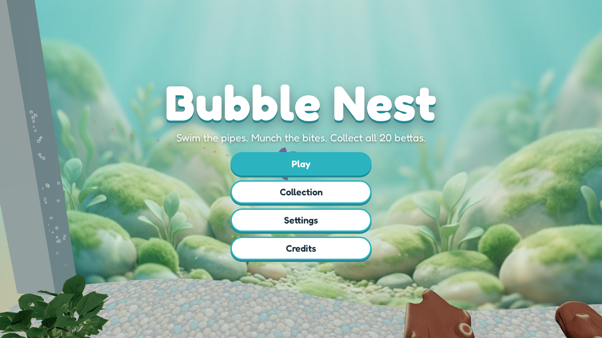
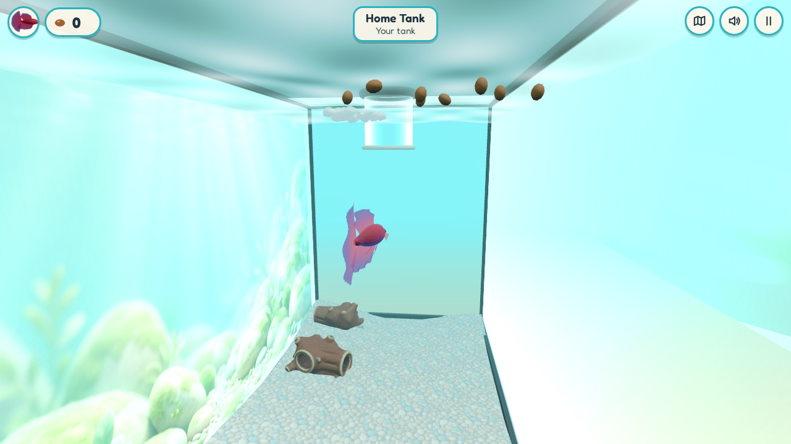
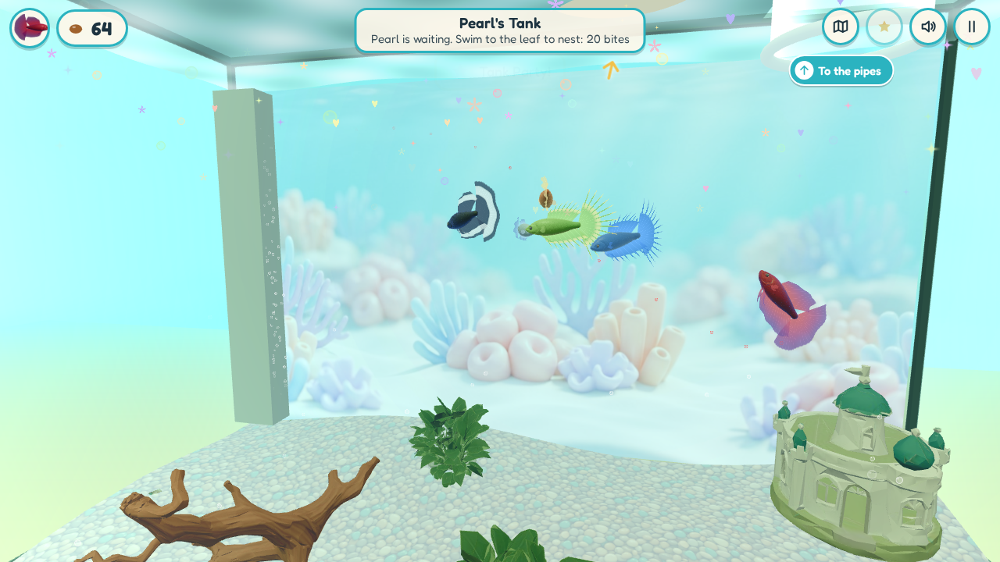
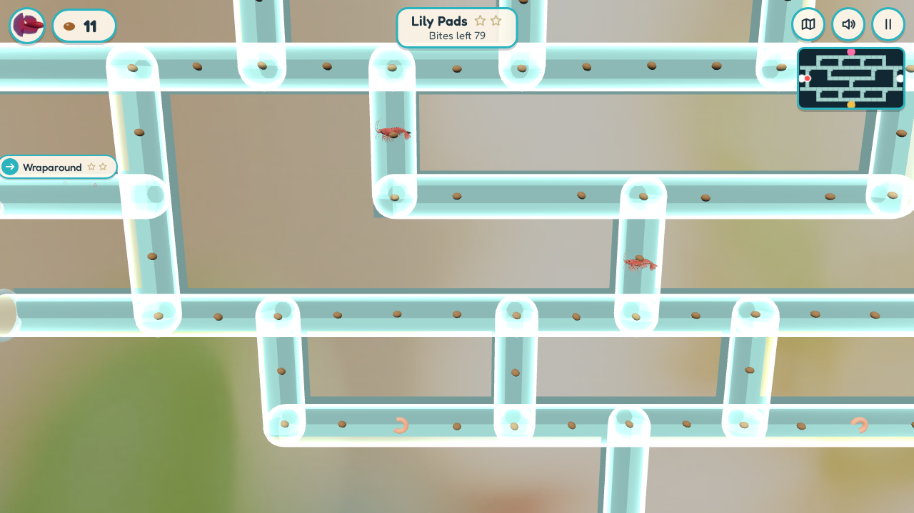
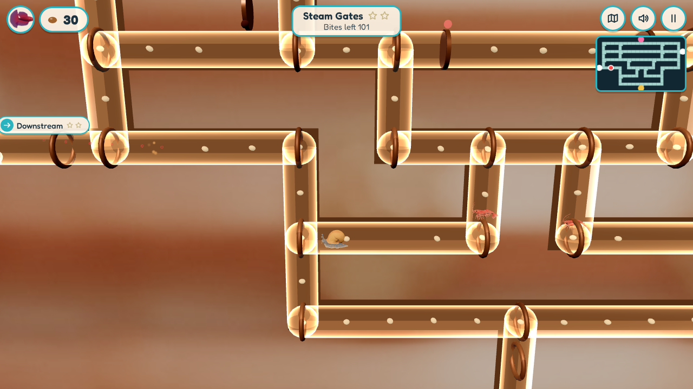
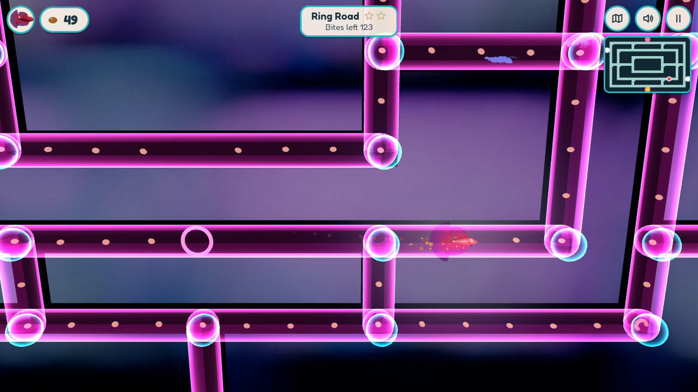
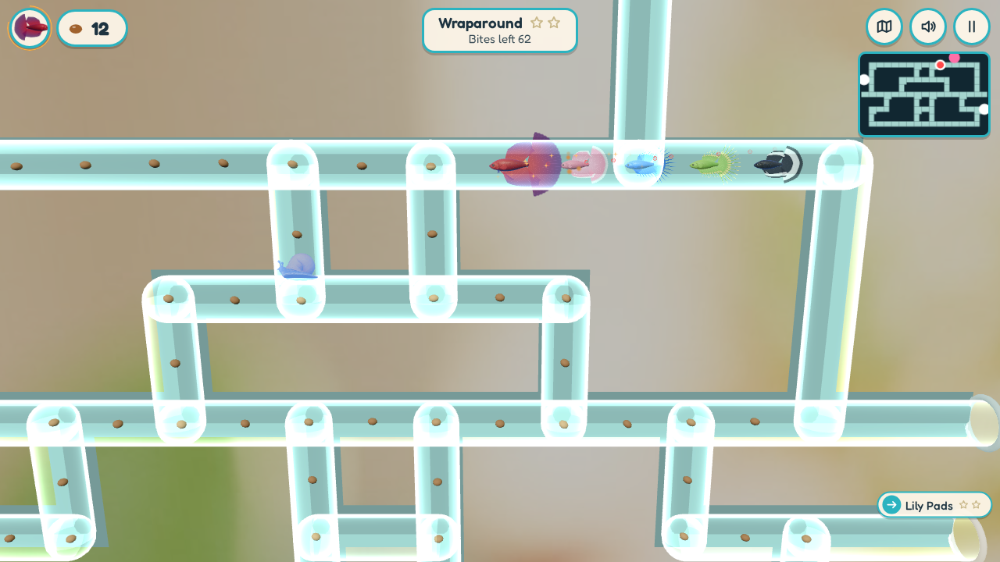
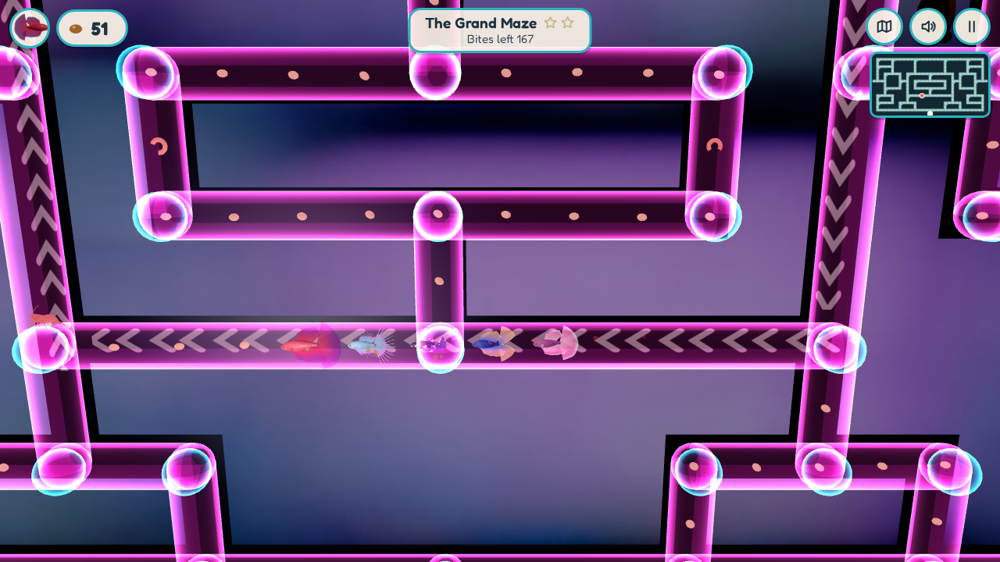

# Bubble Nest

*Swim the pipes. Munch the bites. Build the nests. Collect all 20 bettas.*

You're a betta fish in a little tank with a glass tube hanging into it. Swim up the tube and the world becomes a glowing maze of water pipes: munch trails of betta bites, flare your gills to chase off snails and shrimp, and follow the pipes to other tanks. Claim empty tanks with a bubble nest, meet lady bettas, raise their fry, and become each new fish. You can't lose, only collect.

**[▶ Play Bubble Nest](https://bubblenest.synapticnoise.com/)** in your browser. No install, works on desktop and on phones held sideways.

## Your tank

Every adventure starts in a tank. Click or tap where you want to swim, eat the bites floating on top, and swim up into the glowing tube (or press **To the pipes**). Tanks are where you build bubble nests, meet lady bettas and watch your fry grow. Every tank has a female betta living in it, your school fans out to swim around with you, and once you have five bettas you can throw a **Tank Party**.

## The pipe worlds

| | |
|---|---|
|  |  |
| **Clearwater:** clear glass pipes on a sunny windowsill. Learn the ropes: bites, brine shrimp, snails, darting shrimp and wrap-around tunnels. | **Copperworks:** pipes in copper fittings in a warm boiler room. Ride the currents, time the steam valves and dodge the crayfish. |
|  |  |
| **Neon Night:** an aquarium shop after hours. The pipes are dark, portal rings whisk you across the maze, and jellyfish pulse. | **Your school:** the bettas you've collected swim along behind you through the pipes. |

19 named mazes, 28 tanks, 19 lady bettas and 20 bettas to collect, each with its own colours, fins and personality.

## How to play

- **In a tank:** click (or tap) where you want to swim, or hold the button and steer. Click a bite to go and eat it; click the tube, or the **To the pipes** sign, to swim up into it. WASD works too: W swims where the camera looks, A and D turn, S backs up, Space rises and Shift dives. Right-drag (or drag a finger) to look around.
- **In the pipes:** arrow keys or WASD to turn (or hold the mouse button). You keep swimming until you hit a wall. Snails, shrimp and friends block the pipes: bump one and you flinch back and drop some bites. Press Space (or tap **Flare**) to spend a few bites and flare, and while you're flared you can eat them. Brine shrimp give a free flare.
- **Nests and fry:** exit signs show what's beyond and what a nest costs. Swim to the floating leaf to build a nest. Empty tanks become yours (with a feeder and a new bubble trail). Lady bettas lay eggs; they hatch and grow as you eat bites anywhere, and then you can become the grown fry.
- **Action:** E or Enter. **Map:** Tab. **Pause:** Esc or P. **Mute:** M.
- **On a phone** (sideways): tap to swim, drag to look, the stick on the left and the arrow buttons work too, and you swipe to turn in the pipes. You can install it from your browser's menu to play full screen, even offline.

Enemies only knock bites out of you, so you can never lose. Progress saves automatically in your browser.

## More to discover

*Light spoilers.*

- **Bubble machines:** at the end of a world, a bubble machine carries you somewhere new. Where it takes you is part of the fun.
- **The Grand Maze:** collect 15 bettas and a sealed gate in Neon Night opens onto the biggest maze of all, home of King Claw. Flare and bump him three times to win the Crown bubble trail.

## How it was made

Bubble Nest was made by [Claude Code](https://claude.com/claude-code) with
[gamegen](https://github.com/zeveck/gamegen), from this request:

> --budget 50 We want a 3d game in which you play as a betta fish. The gameplay is arcade simple with some twists. You start able to 3d navigate with mouse or touch around your small tank looking around and nibbling some betta bites floating on the surface. But there's a water filled tube coming down from the top of your tank, and you can swim up into it. When you enter it, you're still 3d but it's basically mechanically be 2d, almost like Pac-Man, except you're swimming. A core mechanic is eating betta bites. The tubes are just a bunch of mazes, again similar to Pac Man difficulty, in which you can munch betta bites and avoid enemies and they branch like pipes or whatever, but they lead to other tanks. Some are empty, some include female bettas. If empty, and you have Z bites, you can claim it by making a bubble nest. If a female betta, you may also make a bubble nest, and then she'll lay a fry and they'll hatch after you gain N bites, and the fry grow up after you eat M more bites, and you can switch to being the fry if you want. Each time you be a new fish, it adds to your betta collection. There's a large network of pipes and passage gets harder and you need more more for the placeholder numbers I gave and they get longer and there are more enemies, but enemies mostly just cause you to lose bites somehow and you can't die. There little to know story, just a pipework of fish, food, and fun, swimming through tubes and getting new tanks and meeting lady fish and getting fry trying to collect all 20 fish or something. It's all bettas. After a while there'll be a pipe with a bubble machine, and if you swim in the betta is put in a 3d bubble they can "float" around a simple room, and it can "dock" at other bubble machines to enter other networks of pipes. There should be three "pipe worlds" with different styles and the like. So it's kinda 3d when you're in a tank, and when you're in the bubble, with 3d controls. But it's kinda simple 2d for the pipes, which is most of the game. Good luck!

gamegen wrote a brief and a design, had review agents (a player, an engineer and an art director) critique it over two rounds, made the art, models, music and sound with these plugins, built the game in three.js, and play-tested it (an autopilot crossed every maze between every pair of exits, and a test run went from New Game to the Full Collection ending):

- [meshgen](https://github.com/zeveck/meshgen): the 3D betta bodies (male and female), snail, shrimp, crayfish, bubble machine, sleeping cat, armchair and the tank decorations. The fins are built in code on top of the bodies, so 20 bettas share two models.
- [imagegen2](https://github.com/zeveck/imagegen2): the Rust concept art that set the style, the concept pictures the 3D models were made from, and the app icon.
- [nanogen](https://github.com/zeveck/nanogen): the title art, the three world panoramas, the tank posters, gravel and room textures.
- [audiogen](https://github.com/zeveck/audiogen): the music for each world and the tanks, the victory sting, and 42 sound effects.

Then it was published, after this reply to the confirmation:

> I added it to DNS. Go ahead.

### The first update

At the end of the first run, gamegen suggested three ideas for what to add next:

> `/gamegen --change make the tank camera frame the fish and the nest leaf better, and add a little celebration when the bubble nest finishes`

> `/gamegen --change add a boss-style "Grand Maze" in Neon Night that opens once you have 15 bettas`

> `/gamegen --change let collected fish follow you as a little school through the pipes`

The request was to do all three, and to make the tank much nicer to swim in:

> Do each of the three Ideas for next you proposed and update the README to include the proposal and running of them, with this and them quoted as part of the making of. I like the tank, but I can't control the betta enough to feel like I'm swimming around, and can't easily get into the tube. We def need to improve the playability of this part as it should be key and its how you start.

What changed:

- **Swimming in the tanks:** you now click or tap where you want to go (or hold and steer), and keyboard swimming follows the camera. The fish turns faster, the camera looks in through the clear glass instead of hugging the walls, and it holds still while you steer. The tube is easier to enter, and a **To the pipes** sign (with an arrow when it's off screen) can be tapped to swim straight up into it. A review agent checked the new controls before they were built, and it was play-tested with mouse-only, touch-only and keyboard runs. With the mouse alone, a new player eats every starting bite and is in the pipes in about seven seconds of play.
- **Nest framing and celebration:** the camera frames the leaf while you build and court, and a finished nest bursts with sparkles, hearts and bubbles.
- **The Grand Maze:** a new 31x17 maze in Neon Night behind a gate that opens at 15 bettas, with King Claw, a big golden crayfish who chases you. Bump him three times while flaring to win the Crown bubble trail. The maze was drawn and checked by the same tool as the others.
- **Your school:** up to four of your collected bettas follow you through the pipes along the exact path you swam (they can be turned off in Settings).
- **Wording:** the descriptions now just say pipes, and the bubble machine's destination is kept a surprise.

### The second update

The next request:

> The enemies aren't threatening enough. They should block your passage and cause you to flinch back, so you can't just pass through them. They knock down your food amount. You can spend food to temporarily "flare" and when flared you can eat all enemies. Your line of fish should all fan out in any tank. All tanks should have a female betta. There should be a Tank Party button once you have five or more bettas that has all the bettas in the tank have a brief party. The button in the lower right is sometimes hard notice -- such commands should probably appear nearer the fish? It's too easy after entering a tank to accidentally go right back up the pipe. It's sometimes hard to get to the leaf, not sure if better controls or a bigger region or what.

What changed:

- **Solid enemies:** you can't swim through them any more. Bump one and you flinch back away from it, drop a few bites, and wait for your next move; the enemy backs off the other way. A short safety window stops one bump from costing you twice.
- **Flare on demand:** Space, F or the Flare button spends 6 / 10 / 15 bites (by world) to flare. While flared you eat any enemy you touch (+5 bites the first time, +1 after); it comes back a little later. Brine shrimp still give a free flare, and King Claw now has to be eaten three times.
- **Tank life:** your school comes out of the tube after you and fans out around the tank, every tank has a female betta (lady tanks have their lady; homes and empty tanks get a friend such as Coral, Fern or Juniper), and with five bettas a **Tank Party** button sets everyone dancing in a ring with colour-changing lights, confetti and a party jingle (made with audiogen, along with new chomp and flinch sounds).
- **Prompts by the fish:** "Build bubble nest", "Become …" and "Tank Party!" now float beside your fish (with the key on desktop) instead of the bottom-right corner.
- **No accidental trips up the tube:** you arrive swimming down and away from the mouth, and the tube only takes you once you've swum clear of it and come back, or when you tap it or the **To the pipes** sign.
- **Easier leaf:** the nest prompt appears anywhere near the leaf in the top half of the tank, and the **Nest spot** sign can be tapped to swim straight under it.

A review agent checked the plan first (and caught a bounce that could ping-pong you back into a chasing enemy, and a floating "Back to the pipes" that would have brought the accidental exits back). Every maze crossing, a run with enemies on, and the full playthrough were tested again.

The design notes, reviews and asset log are in [`design/`](design/), and the maze layouts and their checker in [`tools/`](tools/).

## Playing locally

Bubble Nest is a plain web page with no build step. Serve the `game` folder with any static web server, for example:

    cd game
    python3 -m http.server 8000

then open http://localhost:8000. (Browsers won't run it straight from the file.)

## Credits

- A game idea by Rich Conlan.
- Built with [three.js](https://threejs.org) (MIT license, bundled in `game/vendor/`).
- Font: [Fredoka](https://github.com/hafontia/Fredoka-One), SIL Open Font License (`game/fonts/OFL.txt`).
